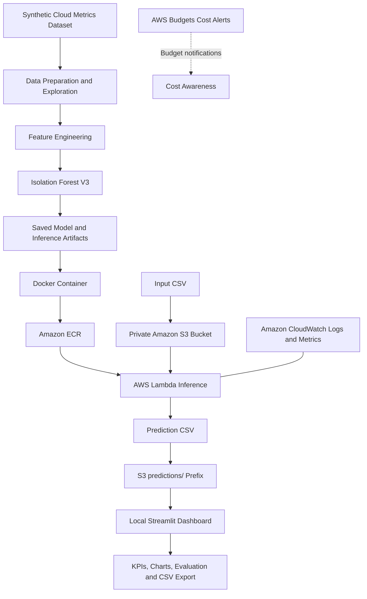

# ☁️ CloudSentinel AI
### Intelligent Cloud Resource Monitoring & Cost Anomaly Detection

CloudSentinel AI is a machine learning-based prototype that detects anomalous patterns in cloud resource metrics. It combines a synthetic cloud-resource dataset, an Isolation Forest model, AWS Lambda container inference, Amazon S3 input/output storage, and a Streamlit dashboard to demonstrate an end-to-end cloud ML workflow.

The project explores how machine learning can help identify unusual resource utilization patterns and potential cost-related anomalies in cloud environments.

> **Project status:** Core ML inference, AWS deployment, S3 prediction storage, and the local dashboard have been implemented and tested. The current dataset and estimated costs are synthetic; this is not a production AWS billing integration.

---

## Table of Contents

- [Overview](#overview)
- [Architecture](#architecture)
- [Features](#features)
- [Dataset](#dataset)
- [Machine Learning Approach](#machine-learning-approach)
- [Evaluation](#evaluation)
- [AWS Implementation](#aws-implementation)
- [Dashboard](#dashboard)
- [Project Structure](#project-structure)
- [Getting Started](#getting-started)
- [Running the Dashboard](#running-the-dashboard)
- [Running Inference on AWS](#running-inference-on-aws)
- [Security and Cost Considerations](#security-and-cost-considerations)
- [Current Limitations](#current-limitations)
- [Future Improvements](#future-improvements)

---

## Overview

Cloud resource utilization can fluctuate because of changes in workload, traffic, memory consumption, and other operational factors. Unusual patterns may indicate inefficient resource usage or potential cost anomalies.

CloudSentinel AI demonstrates a workflow for analyzing resource metrics using an unsupervised anomaly detection model and presenting the resulting predictions through a dashboard.

The prototype currently supports:

- Generating and exploring synthetic cloud-resource metrics.
- Training and evaluating an Isolation Forest anomaly detector.
- Engineering resource-relative deviation features.
- Packaging the trained model and inference code in a Docker image.
- Deploying the container to AWS Lambda.
- Reading CSV input from a private Amazon S3 bucket.
- Saving complete prediction results to a separate S3 output CSV.
- Exploring predictions and evaluation results in Streamlit.

## Architecture

The following diagram represents the implemented workflow. The input CSV is supplied to S3, and the Lambda function is invoked explicitly with the input bucket and key. The dashboard reads the saved prediction CSV from S3 using local AWS credentials.



### Architecture Components

| Component | Purpose |
|---|---|
| Python, pandas and scikit-learn | Data preparation, feature engineering, model training and evaluation |
| Isolation Forest | Detects unusual resource-metric patterns |
| Joblib | Saves and loads model artifacts |
| Docker | Packages inference code, dependencies and model files |
| Amazon ECR | Stores the Lambda container image |
| AWS Lambda | Executes the inference pipeline on demand |
| Amazon S3 | Stores input CSV files and complete prediction outputs |
| Amazon CloudWatch | Provides Lambda logs and execution metrics |
| Streamlit and Plotly | Displays model results through an interactive dashboard |
| AWS Budgets | Provides configured monthly spending alerts |

---

## Features

### 1. Synthetic Data Generation

A synthetic dataset was created to simulate cloud-resource behavior across multiple resources and resource types.

The dataset contains resource utilization metrics, estimated costs, and ground-truth anomaly labels for experimentation and model evaluation.

### 2. Machine Learning-Based Anomaly Detection

An Isolation Forest model is used to identify unusual patterns in resource metrics.

The inference pipeline applies the same feature engineering approach used during training and produces an anomaly prediction and anomaly score for each input record.

### 3. Resource-Relative Feature Engineering

In addition to the original resource metrics, the model uses deviation features based on resource-specific training baselines. This helps characterize how a measurement differs from the expected behavior of that resource.

### 4. AWS Lambda Container Inference

The model and its inference dependencies are packaged into a Docker image and deployed to AWS Lambda.

The function reads a CSV from S3, runs inference, and returns a JSON response containing a summary and prediction preview.

### 5. Complete Prediction Storage

All prediction rows are written to a separate CSV under the S3 `predictions/` prefix. The original input CSV is preserved.

The output includes the available input columns, prediction labels, and anomaly scores.

### 6. Interactive Dashboard

The Streamlit dashboard includes:

- Total records analyzed.
- Predicted anomaly and normal counts.
- Predicted anomaly rate.
- Precision, recall and F1 score when ground-truth labels are available.
- A confusion matrix.
- Predictions grouped by resource.
- Anomaly-score distribution.
- CPU-versus-memory utilization visualization.
- Estimated cost comparisons by resource type.
- Resource, prediction-label and anomaly-type filters.
- Filtered prediction CSV download.
- Refreshing prediction data from the private S3 bucket.

---

## Dataset

The main synthetic dataset contains **14,400 records** representing 30 days of simulated resource metrics sampled at 15-minute intervals across five simulated resources.

The dataset includes 14,300 normal records and 100 labelled anomalies.

| Property | Description |
|---|---|
| Dataset type | Synthetic cloud-resource metrics |
| Total records | 14,400 |
| Simulated duration | 30 days |
| Sampling interval | 15 minutes |
| Simulated resources | 5 |
| Normal records | 14,300 |
| Labelled anomalies | 100 |

### Dataset Columns

| Column | Description |
|---|---|
| `timestamp` | Timestamp of the simulated measurement |
| `resource_id` | Simulated resource identifier |
| `resource_type` | Resource category |
| `cpu_utilization` | CPU utilization metric |
| `memory_utilization` | Memory utilization metric |
| `network_in` | Simulated network input metric |
| `request_count` | Simulated request count |
| `storage_usage` | Simulated storage usage |
| `estimated_cost` | Synthetic estimated cost |
| `is_anomaly` | Ground-truth anomaly label |
| `anomaly_type` | Synthetic anomaly category |

The dataset also includes engineered deviation features used by the V3 model.

### Simulated Anomaly Categories

The generated dataset includes the following labelled patterns:

- CPU spikes
- Memory spikes
- Network spikes
- Cost spikes
- Combined anomalies

**Important:** `estimated_cost` is generated from a synthetic formula. It does not represent actual AWS billing records or charges.

---

## Machine Learning Approach

### Algorithm: Isolation Forest

Isolation Forest is an unsupervised anomaly detection algorithm that identifies observations that are easier to isolate from the rest of the dataset.

CloudSentinel AI uses it to identify unusual combinations of cloud-resource metrics.

### Model Inputs

The original metric features include:

- `cpu_utilization`
- `memory_utilization`
- `network_in`
- `request_count`
- `storage_usage`
- `estimated_cost`

The V3 pipeline additionally uses five resource-relative deviation features:

- `cpu_utilization_deviation`
- `memory_utilization_deviation`
- `network_in_deviation`
- `request_count_deviation`
- `estimated_cost_deviation`

The deviation features are calculated using saved resource baselines derived from training data.

### Training and Evaluation

The V3 model was evaluated using a chronological 80/20 split to reduce the risk of using future observations during training.

| Property | Value |
|---|---:|
| Training records | 11,520 |
| Test records | 2,880 |
| Actual anomalies in holdout | 17 |
| Predicted anomalies in holdout | 20 |

The trained model and supporting inference artifacts are saved using Joblib.

---

## Evaluation

### Chronological Holdout Evaluation

The recorded V3 chronological holdout results are:

| Metric | Result |
|---|---:|
| Precision | 55.00% |
| Recall | 64.71% |
| F1 score | 59.46% |
| True positives | 11 |
| False positives | 9 |
| False negatives | 6 |
| True negatives | 2,854 |

These results correspond to a holdout set containing only 17 ground-truth anomalies. The small number of positive examples means the metrics are preliminary and may vary substantially with a different test sample.

### Balanced 100-Record Test Sample

A separate balanced synthetic test sample containing 50 normal records and 50 labelled anomalies was used to test the deployed inference pipeline.

| Metric | Result |
|---|---:|
| Records processed | 100 |
| Predicted anomalies | 19 |
| Predicted normal | 81 |
| Precision | 100.00% |
| Recall | 38.00% |
| F1 score | 55.07% |

The dashboard calculates these metrics from the ground-truth labels in the saved prediction CSV. They describe this particular balanced sample and must not be confused with the chronological holdout results.

The two evaluations use different samples and should not be compared as though they were the same test.

---

## AWS Implementation

The AWS deployment uses the Mumbai region (`ap-south-1`).

### Amazon S3

A private S3 bucket stores the input metrics and prediction outputs.

Example input object:

```text
samples/cloudsentinel_anomaly_test_sample.csv
```

Example output path:

```text
predictions/cloudsentinel_predictions_<timestamp>_<request-id>.csv
```

The bucket has all four S3 Block Public Access settings enabled. The Lambda execution role has narrowly scoped permissions to read input objects and write prediction objects.

### Amazon ECR and Docker

The inference application, dependencies and saved model artifacts are packaged into a Linux AMD64 Docker image based on the AWS Lambda Python 3.12 runtime image.

The image is stored in a private Amazon ECR repository.

### AWS Lambda

The deployed function is named `CloudSentinelAIInference`.

The tested configuration is:

| Setting | Value |
|---|---|
| Package type | Container image |
| Architecture | x86_64 |
| Memory allocation | 1,024 MB |
| Timeout | 60 seconds |
| Input | S3 bucket and object key |
| Output | JSON summary and S3 prediction CSV |

The function was invoked successfully with a 100-record CSV and returned a successful response with 19 predicted anomalies.

### Amazon CloudWatch

CloudWatch was used to inspect Lambda execution logs, duration, memory usage and error metrics.

A recorded execution reported:

| Measurement | Observed value |
|---|---:|
| Duration | 25.22 seconds |
| Billed duration | 25.223 seconds |
| Maximum memory used | 287 MB |
| Allocated memory | 1,024 MB |

The logs also showed an initialization timeout report and a Joblib warning about operating in serial mode. These observations are retained as performance investigation points rather than treated as proof of an optimized cold start.

### AWS Budgets

A monthly AWS Budget of **$5** was configured with alerts at 50%, 80% and 100%.

A budget is a notification mechanism, not a hard spending cap. Resource usage and actual charges must still be monitored.

---

## Dashboard

The dashboard is implemented using Streamlit, pandas and Plotly. It loads the newest prediction CSV from the private S3 `predictions/` prefix using the developer's local AWS credentials.

It provides an interactive view of the saved inference results, including anomaly counts, evaluation metrics, resource comparisons, anomaly scores, filters and CSV export.


## Project Structure

The following is a logical overview of the repository. Confirm the actual filenames before publishing the final structure.

```text
CloudSentinel-AI/
├── dashboard/
│   ├── app.py
│   └── data/
├── data/
│   ├── raw/
│   └── processed/
├── docs/
│   └── screenshots/
├── lambda_build/
│   ├── Dockerfile
│   ├── lambda_function.py
│   ├── requirements.txt
│   ├── models/
│   └── scripts/
├── models/
│   ├── cloudsentinel_isolation_forest_v3.joblib
│   ├── cloudsentinel_resource_baselines_v3.joblib
│   ├── cloudsentinel_v3_inference_config.joblib
│   └── cloudsentinel_v3_metadata.json
├── notebooks/
│   ├── 01_data_generation.ipynb
│   ├── 02_data_exploration.ipynb
│   ├── 03_anomaly_detection.ipynb
│   └── 04_Advanced_Anomaly_Detection.ipynb
├── scripts/
│   └── inference.py
└── README.md
```

The `lambda_build/` directory contains copies of the model artifacts and inference code required by the Docker build context. These are intentional deployment copies, not separate models.

Generated files, local virtual environments, temporary outputs, AWS credentials and other machine-specific artifacts should be excluded from the published repository where appropriate.

---

## Getting Started

### Prerequisites

- Python 3.10 or a compatible Python environment for the local notebook and dashboard workflows.
- Docker Desktop for building the Lambda container image.
- AWS CLI v2 configured with credentials.
- An AWS account with permissions for the required services.
- Access to the project's private S3 bucket if using the existing deployed workflow.

The Lambda container itself uses the AWS Lambda Python 3.12 base image.

### Install Dashboard Dependencies

From the repository root, run:

```powershell
python -m pip install streamlit pandas plotly boto3
```

Use the Python environment in which you intend to run the dashboard.

### Configure AWS Access

Configure AWS CLI credentials using your own AWS account and an appropriately scoped IAM identity.

Verify the identity:

```powershell
aws sts get-caller-identity
```

Never place AWS access keys or secret keys in the repository, README, notebook outputs or screenshots.

### Prepare the Prediction Data

The dashboard reads prediction CSV files from:

```text
s3://cloudsentinel-ai-102026/predictions/
```

For local development without AWS access, use an appropriate local copy of the prediction CSV and adapt the data-loading section of the dashboard to read it from disk.

---

## Running the Dashboard

From the repository root:

```powershell
python -m streamlit run .\dashboard\app.py
```

Open the local URL printed by Streamlit, usually:

```text
http://localhost:8501
```

The dashboard uses the local AWS credentials configured in the environment. It does not make the S3 bucket public.

The **Refresh from S3** control reloads the latest prediction data. It does not invoke Lambda or generate new predictions by itself.

---

## Running Inference on AWS

The deployed Lambda function accepts an event containing an S3 bucket and object key.

Example test event:

```json
{
  "bucket": "cloudsentinel-ai-102026",
  "key": "samples/cloudsentinel_anomaly_test_sample.csv"
}
```

Save the event as `test-event.json`, then invoke the existing function with AWS CLI:

```powershell
aws lambda invoke `
  --function-name CloudSentinelAIInference `
  --payload fileb://test-event.json `
  --cli-binary-format raw-in-base64-out `
  --region ap-south-1 `
  response.json
```

Inspect the returned JSON:

```powershell
Get-Content .\response.json
```

On a successful invocation, the response includes the input location, output S3 key, number of records processed, predicted anomaly count and a preview of the predictions.

The current handler supports explicit invocation with an S3 object key and an S3 notification event format. An automatic S3 event trigger has not been configured as part of the implemented workflow.

---

## Security and Cost Considerations

- The project bucket is private, with S3 Block Public Access enabled.
- Lambda's S3 permissions are scoped to the required input and output prefixes.
- Prediction output files use server-side encryption with AES256.
- The Streamlit dashboard uses local AWS credentials and does not expose the bucket publicly.
- The AWS Budget provides alerts but does not automatically stop resources.
- Lambda, ECR image storage, S3 storage and CloudWatch logging may incur charges depending on usage and applicable pricing.
- Temporary AWS resources should be reviewed and cleaned up when no longer required.
- Never commit `.aws` credential files, access keys, secret keys, `.env` secrets or personal account information.

---

## Current Limitations

1. **Synthetic data:** The model has been evaluated on generated metrics, not production cloud telemetry.
2. **Estimated costs:** The cost values are synthetic and are not obtained from AWS billing APIs.
3. **On-demand inference:** The tested workflow invokes Lambda explicitly; continuous monitoring and automatic S3-triggered inference are not configured.
4. **Dashboard hosting:** The Streamlit dashboard currently runs locally and is not deployed as a public web application.
5. **Small anomaly evaluation sample:** The chronological holdout contains only 17 actual anomalies, so performance estimates are uncertain.
6. **Cold-start performance:** CloudWatch recorded a slow execution and an initialization timeout report that warrant further investigation.
7. **Prediction persistence:** The current function saves the full CSV and returns only a preview of the predictions in its JSON response.

---

## Future Improvements

Possible future extensions include:

- Integrating real cloud resource metrics through AWS monitoring services.
- Evaluating anomalies against actual billing data.
- Investigating Lambda cold-start latency and optimizing inference initialization.
- Adding automated input processing and scheduled evaluation.
- Improving evaluation using additional datasets and more anomaly examples.
- Hosting the dashboard securely for demonstrations.
- Adding model version tracking and repeatable deployment workflows.

These are future improvements, not features claimed to be implemented in the current version.

---

## Summary

CloudSentinel AI demonstrates an end-to-end machine learning deployment workflow that combines synthetic data generation, anomaly detection, containerized inference, private cloud storage and interactive visualization.

The project provides practical experience with Python, scikit-learn, Docker, Amazon S3, Amazon ECR, AWS Lambda, CloudWatch, IAM, AWS Budgets and Streamlit.

It serves as a foundation for further exploration of cloud observability, machine learning operations and cost-aware resource monitoring.
